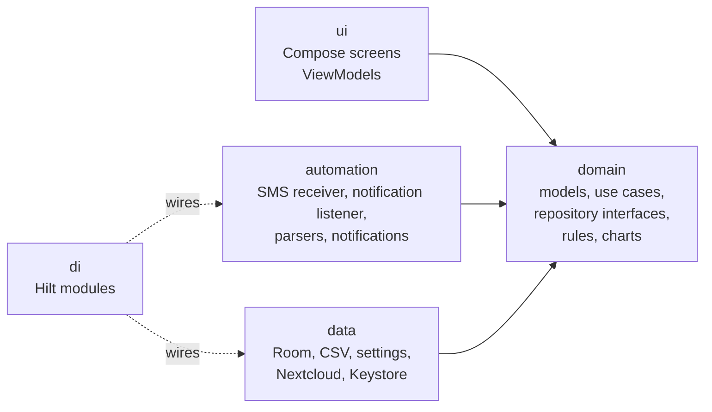
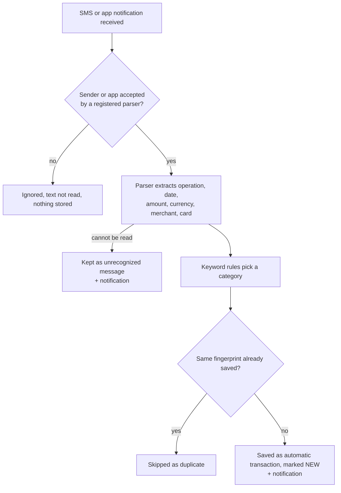

# Spending Tracker

A personal Android app for tracking income and expenses period by period, with automatic capture of card transactions from bank SMS messages and banking app notifications, keyword-based categorization, charts, CSV export/import and monthly backups to a self-hosted Nextcloud.

Built with Kotlin and Jetpack Compose on a layered, test-covered architecture designed to grow feature by feature.

---

## Table of contents

- [Features](#features)
- [Tech stack](#tech-stack)
- [Architecture](#architecture)
- [Project structure](#project-structure)
- [Getting started](#getting-started)
- [Running tests](#running-tests)
- [How it works](#how-it-works)
  - [Money and time](#money-and-time)
  - [Periods and carry-over](#periods-and-carry-over)
  - [Database and migrations](#database-and-migrations)
  - [Bank message automation](#bank-message-automation)
  - [Keyword rules](#keyword-rules)
  - [Charts](#charts)
  - [CSV format](#csv-format)
  - [Nextcloud backup](#nextcloud-backup)
- [Privacy and security](#privacy-and-security)
- [Extending the app](#extending-the-app)
- [Roadmap](#roadmap)
- [Code conventions](#code-conventions)
- [License](#license)

---

## Features

### Tracking
- Add, edit and delete income and expense transactions, with date and time pickers
- Period overview with income, expenses and balance, plus spending per category
- Configurable **month start day** (e.g. payday on the 15th: periods run 15th–14th)
- Optional **carry-over**: each period starts with the balance left from all earlier periods
- Period switcher with a month/year picker for jumping to distant periods
- **Search and filter** across all transactions by text, exact amount, type and category, with totals of the results

### Charts
- One screen: **pie chart** of the period's expenses by category on top, **cash flow chart** below
- Categories under 5 % are merged into "Other"; the list next to the pie shows exactly the pie's slices, with exact amounts and percentages
- **Cash flow chart** of the last 12 periods: green income line, red expense line; exact amounts on request

### Categories and rules
- Default categories created on first launch; add, rename, recolor and delete categories
- Deleting a category keeps its transactions (they become *Uncategorized*) and removes its keyword rules
- Keyword rules assign categories to bank transactions automatically
- Rules screen for adding, editing and deleting rules

### Automation
- Reads card transaction SMS from **DH d.d.** and saves them automatically
- Reads card payment and incoming transfer notifications from the **NLB Pay** app and saves them automatically
- Reads incoming transfer notifications from the **DH Denarnik** app and saves them as income
- SMS from any other sender and notifications from any other app are ignored and never stored
- Duplicate protection for messages delivered or notifications posted more than once
- **Review queue**: automatic transactions are marked *NEW* until confirmed; a Home banner leads to the Review screen with per-item and "Confirm all" confirmation
- Bank messages that can't be read are kept as **unrecognized messages** (copy, try again after a parser update, or delete)
- **"Apply to all future transactions"**: correcting an automatic transaction's category can create a keyword rule from its merchant name
- **Notifications** for new automatic transactions (with category) and unreadable messages; tapping opens the Review screen
- "Test with a message" field to run any bank SMS through the full pipeline

### Data
- **One-file backup**: transactions, categories and keyword rules in a single sectioned CSV file
- CSV export (semicolon-separated, decimal comma, UTF-8 with BOM; opens correctly in Excel and LibreOffice)
- CSV import that only adds data, skips duplicate transactions, restores categories (with colors) and rules, and reports unreadable rows
- Accepts files re-saved by Excel (European date formats, Windows-1250 encoding) and older transactions-only exports
- Monthly automatic backup to Nextcloud over WebDAV, plus a "Back up now" button

### Shared expenses
- Two users (two phones) each keep their own full tracking; only expenses in **split categories** are shared
- **Split categories** with a default share (e.g. 50 %), changeable per expense on the form and in the review queue
- Automatic expenses in a split category arrive pre-ticked as split and are shared only after they are confirmed
- **Sync** with a self-hosted **PocketBase** server (TrueNAS, behind a Cloudflare Tunnel): uploads in the background a few seconds after a change, hourly, on app start and with "Sync now"; works offline and catches up later
- **Shared screen** per period: who paid what, each person's share, a per-category table, and the all-time result "who pays whom how much"
- **Settle-up payments**: record a full or partial payment, see the history, undo mistakes on both phones

### Setup
- **First-launch setup guide** for SMS, banking app notifications, notifications, period settings and backup; can be reopened from Settings

---

## Tech stack

| Area | Technology |
|---|---|
| Language | Kotlin 2.2 |
| UI | Jetpack Compose, Material 3; charts drawn with Compose `Canvas` |
| Architecture | MVVM + clean architecture (UI / domain / data / automation) |
| Dependency injection | Hilt (with KSP) |
| Database | Room 2.8 (SQLite), exported schemas, auto-migrations |
| Async | Kotlin coroutines and Flow |
| Navigation | Navigation Compose |
| Background work | WorkManager |
| Networking | OkHttp 4 (WebDAV) |
| Secrets | Android Keystore (AES-256-GCM) |
| Tests | JUnit 4 (local unit tests) |
| Build | Gradle (Kotlin DSL), version catalog, AGP 9 |

Minimum SDK: **26** (Android 8.0) · Target / compile SDK: **37**

---

## Architecture

The code is split into layers with a strict dependency direction. The **domain** layer is plain Kotlin and knows nothing about Android, Room or the network, which keeps business rules simple to test and safe to change.



**Request flow for a typical screen:**

```
Screen (Compose) → ViewModel (StateFlow<UiState>) → Use case → Repository interface
                                                                   ↓
                                                    Repository implementation → DAO → Room
```

**Key principles**

- **Single source of truth:** the database (and live settings). Screens observe `Flow`s and update automatically when data or settings change.
- **Interfaces at the boundaries:** repositories, `HistoryExporter`, `HistoryImporter`, `CloudStorage`, `BankMessageParser` and `TransactionNotifier` are interfaces with replaceable implementations.
- **Use cases hold business rules:** validation and decisions live in small, single-purpose classes, never in screens.
- **Pure calculators for numbers:** period ranges, category breakdowns, cash flow and axis scales are plain functions with unit tests.
- **Expected failures are values:** operations return `AppResult.Success` / `AppResult.Error` instead of throwing across layers.
- **Screens are stateless:** each screen draws a `UiState` and forwards user actions to its ViewModel.

---

## Project structure

```
com.aljaz.spendingtracker
├── SpendingTrackerApp.kt        # Application: Hilt entry, startup tasks, backup schedule, notification channel
├── MainActivity.kt              # Single activity: setup guide on first launch, notification deep link
├── core/                        # AppResult, MoneyParser, MoneyFormatter, period ranges
├── domain/
│   ├── model/                   # Transaction, TransactionSource, Category, CategoryRule, RecurringTransaction, ...
│   ├── repository/              # Repository interfaces
│   ├── usecase/                 # One class per business action
│   ├── rules/                   # Keyword matching, text normalization, starter rules
│   ├── charts/                  # Category breakdown, cash flow, axis scale
│   ├── settings/                # Period settings interface
│   ├── export/                  # HistoryExporter / HistoryImporter interfaces
│   └── backup/                  # Backup settings, credentials, CloudStorage interface
├── data/
│   ├── local/                   # Room: AppDatabase, entities, DAOs
│   ├── mapper/                  # Entity ↔ domain model conversion
│   ├── repository/              # Room-backed repository implementations
│   ├── settings/                # Period settings and setup-guide flags (SharedPreferences)
│   ├── csv/                     # CSV format, reader, sections, formatters, parsers, exporter, importers
│   └── backup/                  # Nextcloud client, Keystore cipher, settings store, worker, scheduler
├── automation/
│   ├── BankMessageProcessor.kt  # Parse → categorize → deduplicate → save (or keep as unrecognized) → notify
│   ├── parser/                  # BankMessageParser interface, shared BankMessageFields and IncomingTransferFormat,
│   │                            # DhSmsParser, NlbPayParser, DhDenarnikParser
│   ├── sms/                     # SmsReceiver
│   ├── externalnotifications/   # ExternalNotificationListener, notification-access helper
│   └── notifications/           # TransactionNotifier (notifications this app posts), preferences
├── di/                          # Hilt modules
└── ui/
    ├── navigation/              # Routes and NavHost
    ├── components/              # Shared widgets: transaction row, period header, pickers, chips, permissions
    ├── home/                    # Period overview and review banner
    ├── transactions/            # Add / edit form, "Apply to all future transactions"
    ├── categories/              # Category management
    ├── rules/                   # Keyword rule management
    ├── review/                  # Review queue and unrecognized messages
    ├── search/                  # Search and filter
    ├── charts/                  # Pie chart and cash flow chart
    ├── settings/                # Export, import, period, bank SMS, banking apps, notifications, Nextcloud backup
    ├── onboarding/              # First-launch setup guide
    └── theme/

app/schemas/                     # Exported Room schemas (one JSON per database version)
app/src/test/                    # Local unit tests
```

> `automation/notifications` is about notifications the app **shows**; `automation/externalnotifications` is about notifications from **other apps** that the app **reads**.

---

## Getting started

### Requirements
- A recent version of **Android Studio** with Android SDK 37
- An emulator or Android device running Android 8.0 or newer

### Build and run
1. Clone the repository and open the project folder in Android Studio.
2. Let Gradle sync finish.
3. Select an emulator or a connected device (with USB debugging enabled).
4. Click **Run**.

No API keys or local configuration files are required. Nextcloud settings are entered inside the app.

### First launch
The setup guide walks through:
1. **Bank SMS** permission, for automatic transactions from SMS
2. **Banking apps**: notification access, for automatic transactions from banking app notifications (NLB Pay, DH Denarnik)
3. **Notifications** permission (Android 13+)
4. **Month start day** and **carry-over**
5. **Nextcloud backup** (server address, username and an **app password**)

Every step is optional and can be changed later in **Settings**. The guide can be reopened with **Settings → Show setup guide**.

> If the app is installed from an APK file instead of Android Studio, newer Android versions may block the SMS permission and notification access. Open the app's system settings, choose **⋮ → Allow restricted settings**, then grant them.

---

## Running tests

All tests are local JVM unit tests and run in seconds without an emulator.

- **Android Studio:** right-click `app/src/test` → **Run Tests**
- **Command line:**
  ```bash
  ./gradlew test          # macOS / Linux
  gradlew test            # Windows
  ```
- **HTML report:** `app/build/reports/tests/testDebugUnitTest/index.html`

| Test class | Covers |
|---|---|
| `MoneyParserTest` | Parsing typed amounts into cents, formatting them back |
| `TransactionCsvFormatterTest` | Transaction CSV output, escaping, ordering |
| `TransactionCsvParserTest` | CSV reading, round trips, Excel-style dates, error reporting |
| `ConfigurationCsvTest` | Categories and rules sections, colors, round trips |
| `BackupFileTest` | Splitting a backup file into its sections |
| `ScheduledBackupTest` | Monthly backup decision, empty-history guard |
| `DhSmsParserTest` | All supported DH SMS formats, sender matching |
| `NlbPayParserTest` | NLB Pay card payments and incoming transfers, line breaks, thousands separator, package matching |
| `DhDenarnikParserTest` | DH Denarnik incoming transfers, with and without a space before €, package matching |
| `CategoryRuleMatcherTest` | Keyword matching, priorities, whole-word behavior |
| `CreateRuleFromTransactionTest` | Rules created from corrected transactions, typo guard |
| `SaveRuleUseCaseTest` | Saving and editing rules by hand |
| `TransactionFilterTest` | Search by text, amount, type and category |
| `PeriodTest` | Period ranges, month start day, clamping in short months |
| `MonthSummaryTest` | Balance with and without carry-over |
| `CategoryBreakdownTest` | Pie slices, "Other" merging, totals add up |
| `CashFlowTest` | Grouping into periods, round axis maximums |

When fixing a bug, first add a failing test that reproduces it, then fix the code until the test passes.

---

## How it works

### Money and time
- **Amounts** are stored as `Long` minor units (cents): `12.50 EUR` is stored as `1250`. Floating-point types are never used for money.
- **User input** accepts both `12.50` and `12,50` (`MoneyParser`).
- **Timestamps** are stored as UTC epoch milliseconds and converted to local time only for display.
- **Period boundaries** are calculated in the phone's time zone, so a purchase at 23:30 on the last day belongs to that period.

### Periods and carry-over
- A **period** is the app's month. With month start day **1** it is the calendar month. With e.g. **15**, the period called *October* runs from 15 October to 14 November: it is **named after the month it starts in**.
- If the start day doesn't exist in a month (29–31), that period starts on the month's last day.
- The **current period** depends on today: on 10 October with start day 15, the current period is *September*.
- With **carry-over** on, a period's balance is *income − expenses + everything left from earlier periods*. The carried amount is computed by one SQL sum over all transactions before the period start, so it stays fast and updates live.
- The monthly cloud backup and the CSV files are not affected by period settings.

### Database and migrations

Room database `spending_tracker.db`, with the schema of every version exported to `app/schemas/`.

| Version | Change | Migration |
|---|---|---|
| 1 | `transactions` table | — |
| 2 | `categories` table | Auto-migration |
| 3 | `category_rules` table | Auto-migration |
| 4 | `unrecognized_messages` table | Auto-migration |
| 5 | `recurring_transactions` table | Auto-migration |
| 6 | `transactions.recurringId` column | Manual (`MIGRATION_5_6`) |

Enums such as `TransactionSource` are stored **by name**, so adding a new value (e.g. `NOTIFICATION`) needs no migration, but renaming one does.

Small settings (period settings, notification switch, setup-guide flag, backup settings) live in private `SharedPreferences`; the Nextcloud app password is stored only in encrypted form.

**Changing the schema:**
1. Change or add the entity.
2. Increase `version` in `AppDatabase` and add a migration (auto-migration where possible).
3. Add a line to the version history comment in `AppDatabase` and to the table above.
4. Build, then test by running the app **over the existing installation**, never by uninstalling first.

> Never edit or delete the files in `app/schemas/`. Auto-migrations are generated from them.

### Bank message automation

Bank transactions arrive through two channels that share one pipeline:

| Channel | Entry point | "Sender" | Source saved |
|---|---|---|---|
| SMS | `SmsReceiver` | SMS sender name, e.g. `DH d.d.` | `SMS` |
| App notification | `ExternalNotificationListener` | App package, e.g. `si.nlbpay.slovenija`, `si.delavskahranilnica.dhdenarnik` | `NOTIFICATION` |



**Supported formats:**

DH d.d. (SMS), card payment:
```
Obvestilo o transakciji: POS NAKUP, 13.10.2026 15:37, kartica ***1754, znesek 161,77 EUR, BS LOGO BREZOVICA. DH d.d.
```

NLB (NLB Pay notification), card payment and incoming transfer:
```
POS NAKUP 19.10.2026 11:52, kartica ***5802, znesek 10,96 EUR, CHUTIS LJUBLJANA SI. Info: 0038614772000. NLB
20.09.2026 - Prejeli ste 6.40€ od Janez D.
```

DH d.d. (DH Denarnik notification), incoming transfer:
```
23.10.2026 - Prejeli ste 5.00 € od Sabina P.
```

Incoming transfers ("Prejeli ste") look the same in both apps, so `IncomingTransferFormat` reads them for both parsers. They have no time, so the date at 00:00 is used; two transfers on the same day with the same amount from the same person are therefore treated as one (add the second by hand). The amount must have exactly two decimals and no thousands separator; anything else goes to *Unrecognized messages* rather than being guessed.

| Operation | Meaning | Type |
|---|---|---|
| `POS NAKUP` | In-store card payment | Expense |
| `SPLET/TEL NAKUP` | Online or phone payment | Expense |
| `BA DVIG` | ATM withdrawal | Expense |
| `PREJELI STE` | Incoming transfer | Income |

Unknown operations are not saved as transactions, so the app never guesses; they appear under *Unrecognized messages* instead. Date, amount, operation and merchant handling is shared by all parsers in `BankMessageFields`.

**Notification details:**
- Requires **Notification access** (Settings → Banking apps, or the setup guide). It is a special permission without a dialog; the app opens the system settings screen.
- The expanded text (`EXTRA_BIG_TEXT`) is used when the app provides it, otherwise the normal text (`EXTRA_TEXT`).
- Group summary notifications (empty "headers" that bundle several notifications) are skipped.
- When the listener (re)connects, bank notifications still in the shade are processed too, so payments posted while the app wasn't listening aren't missed. Already-saved ones are skipped as duplicates; unreadable ones found this way are not stored again.
- To test without a real payment, temporarily let `NlbPayParser.acceptsSender` accept `com.android.shell`, then post a fake notification:
  ```
  adb shell "cmd notification post -t 'NLB Pay' nlbtest 'POS NAKUP 19.10.2026 18:55, kartica ***5802, znesek 1,23 EUR, TEST SHOP SI. Info: 1. NLB'"
  ```
  Don't use `-S bigtext`: it replaces the expanded text with a built-in sample. Revert the test change afterwards.

### Keyword rules

A rule says *"when this keyword appears in the merchant (or the operation), use this category"*.

- **Whole words only**, ignoring case and punctuation: `ZET` matches `ZET` but not `ZETA SHOP`; `eBay O*19-15244` is compared as `EBAY O 19 15244`.
- **Priority when several rules match:**
  1. Operation rules beat merchant rules (every `BA DVIG` is *ATM*)
  2. The longest keyword wins (most specific)
  3. The newest rule wins a tie
- Each keyword points to exactly one category; saving the same keyword again replaces the old rule.
- Starter rules are created on first launch (`StarterRules.kt`), together with any categories they need.
- New rules come from **"Apply to all future transactions"** in the edit form of an automatic transaction (SMS or notification; the keyword must appear in that merchant's name) and from the **Rules screen** (Categories → Rules).
- For incoming transfers the merchant is the sender's name, so a rule like `SABINA P` sorts transfers from one person; an operation rule `PREJELI STE` sorts all incoming transfers (and then always wins over per-person rules).
- Rules apply to all banks and channels alike.
- Deleting a rule never changes transactions that were already saved.

### Charts

Opened with **Charts >** in Home's summary card, on the period Home is showing.

Both charts are on one screen, below the period switcher.

- **By category (top):** a pie of the period's expenses with the list of categories to its right. Categories under 5 % are merged into one "Other" slice (a single small category keeps its own slice). The list shows exactly the pie's slices, "Other" included, with exact amounts and percentages, so it always adds up to the total.
- **Cash flow (below):** 12 periods ending with the selected one; income in green, expenses in red. The Y axis uses round values (steps of 1, 2, 2.5 or 5 × 10ⁿ euros). **Show amounts** opens a table with the exact amounts, newest first.
- Both charts follow the month start day and are drawn with Compose `Canvas`, without a chart library.

### CSV format

A complete backup is **one file** with three sections, each starting with a marker line and its own header:

```
[Transactions]
Date;Type;Amount;Currency;Category;Title;Note;Source
2026-10-11 19:38;Expense;11,27;EUR;Car / Fuel;BS LOGO BREZOVICA;;SMS
2026-10-19 11:52;Expense;10,96;EUR;Groceries;CHUTIS LJUBLJANA SI;;NOTIFICATION
2026-10-14 08:15;Income;1500,00;EUR;Salary;October salary;;MANUAL

[Categories]
Name;Type;Color
Car / Fuel;Expense;#F44336

[Rules]
Keyword;Looks at;Category;Category type
BS LOGO;Merchant;Car / Fuel;Expense
```

| Property | Value |
|---|---|
| Separator | `;` |
| Decimal mark | `,` (no thousands grouping) |
| Encoding | UTF-8 with BOM |
| Line ending | `\r\n` |
| Date | `yyyy-MM-dd HH:mm`, local time |
| Amount | Always positive; `Type` says income or expense |
| Source | `MANUAL`, `SMS`, `NOTIFICATION`, `WALLET`, `IMPORT` or `RECURRING` |
| Colors | `#RRGGBB` |
| Quoting | Standard CSV: fields containing `;`, `"` or line breaks are quoted, inner quotes doubled |
| Row order | Transactions oldest first |

**Import** recognizes each section by its header row and imports categories first, then rules, then transactions. It also accepts files without section markers (older transactions-only exports), `d.M.yyyy H:mm` dates and Windows-1250 encoded files (as saved by Excel on Slovenian systems). Transactions are matched as duplicates by date (to the minute), type, amount, currency and title.

### Nextcloud backup

- Uses Nextcloud's built-in WebDAV endpoint: `<server>/remote.php/dav/files/<username>/<folder>/`
- Each backup uploads the complete file as `spending_backup.csv`, replacing the previous one. Nextcloud's file versioning keeps older copies (file details → *Versions*).
- A WorkManager job runs **once a day when the phone is online** and uploads only if no backup succeeded yet in the current calendar month. Failed uploads are retried with exponential backoff.
- An **empty history is never uploaded**, so a fresh install cannot overwrite a real backup.
- **Restoring** after a phone reset: download `spending_backup.csv` from Nextcloud and import it in Settings.

---

## Privacy and security

- **SMS:** only messages from registered bank senders are read. All others are dropped before parsing and never stored or logged. Message bodies are never written to the log. Bank messages that can't be parsed are stored locally only, so the user can inspect or delete them.
- **Other apps' notifications:** Android shows the listener every notification on the phone. The package name is checked against the registered parsers **before** any text is read; notifications from all other apps are ignored and never stored or logged. Only the result type ("Saved", "Duplicate", …) is logged, never the text. Access can be revoked at any time in the system's *Notification access* settings.
- **Receiver protection:** the SMS receiver requires the `BROADCAST_SMS` permission and the notification listener requires `BIND_NOTIFICATION_LISTENER_SERVICE`, so only the Android system can deliver messages to them.
- **Notifications** shown by the app display amount, merchant and category on the lock screen according to the phone's notification settings; they can be turned off in the app.
- **Credentials:** the Nextcloud **app password** is encrypted with an AES-256-GCM key held in the Android Keystore; the key never leaves the device. After restoring the app on another device the password must be entered again.
- **Transport:** server addresses must use `https://`. Plain HTTP is rejected.
- **Least privilege:** use a Nextcloud *app password* (revocable at any time), never the account password.
- **Local data:** stays on the device except for the CSV files the user exports and the backups uploaded to the user's own server.

> If this repository is ever made public, review test fixtures and sample messages for personal details first.

---

## Extending the app

### Support a new message format from a supported bank
1. Copy the real message (Review → Unrecognized messages → **Copy**) into a new test in that bank's test class (`DhSmsParserTest`, `NlbPayParserTest`, `DhDenarnikParserTest`). Run it and confirm it fails.
2. Update the parser (often one line in `BankMessageFields.typeOf()` or the parser's `PATTERN`). If the format is shared (`IncomingTransferFormat`), run the tests of every bank that uses it.
3. Run all tests until everything is green, then use **Try again** on the stored message.

### Support another bank, banking app or Google Wallet
1. Create a class in `automation/parser` implementing `BankMessageParser`, with its own test class.
   - `acceptsSender`: the SMS sender name for SMS, or the **app's package name** for notifications (find it in the app's Play Store link after `id=`).
   - `parse`: reuse `BankMessageFields` for dates, amounts, operations and merchant names. If the app sends a format another bank already uses (e.g. "Prejeli ste"), call the shared format object (`IncomingTransferFormat.parse`) instead of copying its pattern; if its text differs, give the parser its own pattern.
2. Register it in `di/AutomationModule.kt` with one `@Binds @IntoSet` function.

`BankMessageProcessor`, the notification listener's whitelist, the keyword rules, duplicate detection, notifications and the review queue work with it unchanged.

### Add a screen
1. Add a route to `ui/navigation/Screen.kt`.
2. Create the `UiState`, `ViewModel` and `Screen` in a new package under `ui/`.
3. Register the route in `AppNavHost`.

### Add an export format or cloud provider
Implement `HistoryExporter` / `HistoryImporter` or `CloudStorage` and bind the new implementation in the matching Hilt module.

---

## Roadmap

| Milestone | Status |
|---|---|
| 1. Project foundation: Hilt, Room, navigation |  Done |
| 2. Manual add, edit and delete; month overview |  Done |
| 3. Categories, per-category spending, category management |  Done |
| 4. CSV export/import, Nextcloud backup |  Done |
| 5. Bank SMS automation: parser, rules, review queue, unrecognized messages, rule management |  Done |
| 6. Google Wallet notifications |  Deferred (Wallet payments already arrive as bank SMS; the notification listener from milestone 10 makes it one parser class) |
| 7. Polish and everyday comfort |  Done |
| &nbsp;&nbsp;7.1 Date and time picker |  Done |
| &nbsp;&nbsp;7.2 Categories and rules in the (single-file) backup |  Done |
| &nbsp;&nbsp;7.3 Search and filter |  Done |
| &nbsp;&nbsp;7.4 Notifications for new SMS transactions |  Done |
| &nbsp;&nbsp;7.5 First-launch setup guide |  Done |
| &nbsp;&nbsp;7.6 Pie chart by category |  Done |
| &nbsp;&nbsp;7.7 Cash flow chart |  Done |
| &nbsp;&nbsp;7.7a Both charts on one screen |  Done |
| &nbsp;&nbsp;7.8 Month start day |  Done |
| &nbsp;&nbsp;7.9 Carry-over mode |  Done |
| 8. Testing, polish and release preparation |  Planned |
| 9. Repeating transactions |  In progress |
| 10. Banking app notifications (NLB Pay, DH Denarnik) |  Done |
| &nbsp;&nbsp;10.1 Notification listener and access setting |  Done |
| &nbsp;&nbsp;10.2 NLB Pay parser, shared `BankMessageFields` |  Done |
| &nbsp;&nbsp;10.3 Listener → processor, `NOTIFICATION` source |  Done |
| &nbsp;&nbsp;10.4 Setup guide page and Settings card |  Done |
| &nbsp;&nbsp;10.5 Incoming transfers as income (NLB Pay) |  Done |
| &nbsp;&nbsp;10.6 DH Denarnik parser, shared `IncomingTransferFormat` |  Done |
| 11. Shared expenses with a partner (PocketBase on TrueNAS) |  In progress |
| &nbsp;&nbsp;11.1 PocketBase server: collections, API rules, Cloudflare Tunnel |  Done |
| &nbsp;&nbsp;11.2 Split categories and sync fields (database v7) |  Done |
| &nbsp;&nbsp;11.3 Shared account login |  Done |
| &nbsp;&nbsp;11.4 Split input on the form and in the review queue |  Done |
| &nbsp;&nbsp;11.5 Sync engine: upload, deletions, mirror download, clean-up (database v8) |  Done |
| &nbsp;&nbsp;11.6 Shared summary screen |  Done |
| &nbsp;&nbsp;11.7 Settle-up payments (database v9) |  Done |
| &nbsp;&nbsp;11.8 Backup account screen |  Done |
| &nbsp;&nbsp;11.9 "Count only my share" on Home and Charts |  On hold (see below) |
| &nbsp;&nbsp;11.10 Notification when the partner adds a shared expense |  Skipped (not needed for now) |
| &nbsp;&nbsp;11.11 Split settings in the Nextcloud backup |  Planned |

### On hold: "Count only my share" (11.9)

By default, Home and Charts count a split expense with the **whole amount**, the money that actually left the bank account. A €100 grocery bill split 50/50 counts as €100.

The planned option, a **Count only my share** switch in *Settings → Shared expenses*, would make Home and Charts count only this user's part (€50 in the example):

- Home summary, *Spending by category*, the carried-over balance and both charts would use the share; the summary label would read *Expenses (my share)*
- The transaction list would keep showing the whole amount, with an extra line such as *"split, my share €50.00"*
- One helper (`Transaction.countedAmountMinor(onlyMyShare)` next to `SplitMath`) would do the calculation everywhere, and the carry-over SQL query would use the same rounding
- Expenses the partner paid would still appear only on the Shared screen, since they are not this user's bank transactions

The design is finished but not built; it is on hold until it is needed.

**Ideas for later:** week start day and weekly view, budgets per category, multi-currency, home screen widget, applying a new rule to past uncategorized transactions, tap-to-inspect values on the cash flow chart, a "Test with a message" option for notification formats.

---

## Code conventions

- Every public class and function has a **KDoc** comment; comments explain *why*, not *what*.
- One responsibility per class; one business action per use case.
- No business logic in screens or ViewModels beyond presentation.
- Money as `Long` minor units; time as UTC epoch milliseconds.
- New logic comes with unit tests; parsers are tested against real messages.
- Shared UI pieces live in `ui/components` instead of being copied between screens.
- Format code with **Ctrl+Alt+L** and clean imports with **Ctrl+Alt+O** (Android Studio) before committing.
- Commit after every working step, with a message describing the step.

---

## License

To be decided. Until then, all rights reserved.