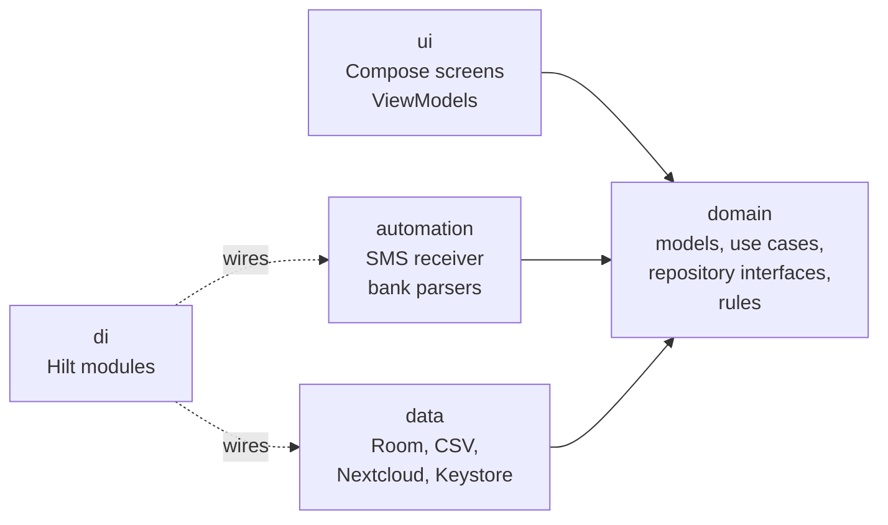
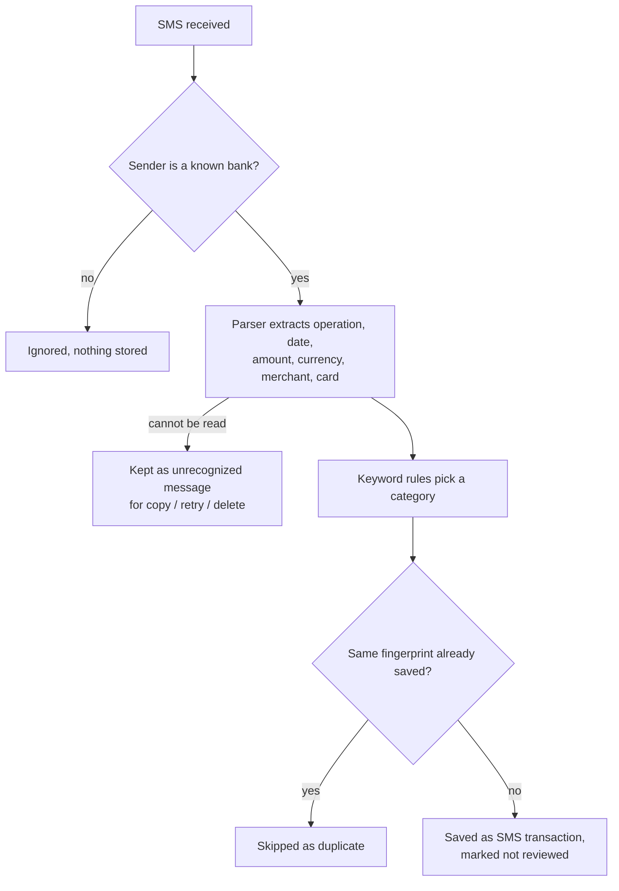

# Spending Tracker

A personal Android app for tracking monthly income and expenses, with automatic capture of card transactions from bank SMS messages, keyword-based categorization, CSV export/import and monthly backups to a self-hosted Nextcloud.

Built with Kotlin and Jetpack Compose on a layered, test-covered architecture designed to grow feature by feature.

---

## Table of contents

- [Features](#features)
- [Tech stack](#tech-stack)
- [Architecture](#architecture)
- [Project structure](#project-structure)
- [Getting started](#getting-started)
- [Running tests](#running-tests)
- [How it works](#how-it-works)
  - [Money and time](#money-and-time)
  - [Database and migrations](#database-and-migrations)
  - [Bank SMS automation](#bank-sms-automation)
  - [Keyword rules](#keyword-rules)
  - [CSV format](#csv-format)
  - [Nextcloud backup](#nextcloud-backup)
- [Privacy and security](#privacy-and-security)
- [Extending the app](#extending-the-app)
- [Roadmap](#roadmap)
- [Code conventions](#code-conventions)
- [License](#license)

---

## Features

### Tracking
- Add, edit and delete income and expense transactions
- Monthly overview with income, expenses and balance
- Spending per category for the selected month
- Month switcher with a month/year picker for jumping to distant months
- Transaction list with category color, name and date

### Categories
- Default categories created on first launch
- Add, rename, recolor and delete categories
- Deleting a category keeps its transactions (they become *Uncategorized*) and removes its keyword rules

### Automation
- Reads card transaction SMS from **DH d.d.** and saves them automatically
- Messages from any other sender are ignored and never stored
- Automatic categorization through keyword rules (merchant or operation based)
- Duplicate protection for messages delivered more than once
- Review queue: automatic transactions are marked *NEW* until confirmed; a Home banner leads to the Review screen with per-item and "Confirm all" confirmation
- Bank messages that can't be read are kept as *unrecognized messages* (copy, try again after a parser update, or delete)
- "Apply to all future transactions": correcting an automatic transaction's category can create a keyword rule from its merchant name
- Rules screen for adding, editing and deleting keyword rules
- "Test with a message" field to run any bank SMS through the full pipeline

### Data
- CSV export of the complete history (semicolon-separated, decimal comma, UTF-8 with BOM, opens correctly in Excel and LibreOffice)
- CSV import that only adds data, skips duplicates, creates missing categories and reports unreadable rows
- Accepts files re-saved by Excel (European date formats, Windows-1250 encoding)
- Monthly automatic backup to Nextcloud over WebDAV, plus a "Back up now" button

---

## Tech stack

| Area | Technology |
|---|---|
| Language | Kotlin 2.2 |
| UI | Jetpack Compose, Material 3 |
| Architecture | MVVM + clean architecture (UI / domain / data / automation) |
| Dependency injection | Hilt (with KSP) |
| Database | Room 2.8 (SQLite), exported schemas, auto-migrations |
| Async | Kotlin coroutines and Flow |
| Navigation | Navigation Compose |
| Background work | WorkManager |
| Networking | OkHttp 4 (WebDAV) |
| Secrets | Android Keystore (AES-256-GCM) |
| Tests | JUnit 4 (local unit tests) |
| Build | Gradle (Kotlin DSL), version catalog, AGP 9 |

Minimum SDK: **26** (Android 8.0) · Target / compile SDK: **37**

---

## Architecture

The code is split into layers with a strict dependency direction. The **domain** layer is plain Kotlin and knows nothing about Android, Room or the network, which keeps business rules simple to test and safe to change.



**Request flow for a typical screen:**

```
Screen (Compose) → ViewModel (StateFlow<UiState>) → Use case → Repository interface
                                                                   ↓
                                                    Repository implementation → DAO → Room
```

**Key principles**

- **Single source of truth:** the database. Screens observe `Flow`s and update automatically when data changes.
- **Interfaces at the boundaries:** repositories, `HistoryExporter`, `HistoryImporter`, `CloudStorage` and `BankMessageParser` are interfaces with replaceable implementations.
- **Use cases hold business rules:** validation and decisions live in small, single-purpose classes, never in screens.
- **Expected failures are values:** operations return `AppResult.Success` / `AppResult.Error` instead of throwing across layers.
- **Screens are stateless:** each screen draws a `UiState` and forwards user actions to its ViewModel.

---

## Project structure

```
com.aljaz.spendingtracker
├── SpendingTrackerApp.kt        # Application: Hilt entry, startup tasks, backup schedule
├── MainActivity.kt
├── core/                        # AppResult, MoneyParser, MoneyFormatter, month ranges
├── domain/
│   ├── model/                   # Transaction, Category, CategoryRule, MonthOverview, defaults
│   ├── repository/              # Repository interfaces
│   ├── usecase/                 # One class per business action
│   ├── rules/                   # Keyword matching, text normalization, starter rules
│   ├── export/                  # HistoryExporter / HistoryImporter interfaces
│   └── backup/                  # Backup settings, credentials, CloudStorage interface
├── data/
│   ├── local/                   # Room: AppDatabase, entities, DAOs
│   ├── mapper/                  # Entity ↔ domain model conversion
│   ├── repository/              # Room-backed repository implementations
│   ├── csv/                     # CSV format, reader, formatter, parser, exporter, importer
│   └── backup/                  # Nextcloud client, Keystore cipher, settings store, worker
├── automation/
│   ├── BankMessageProcessor.kt  # Parse → categorize → deduplicate → save (or keep as unrecognized)
│   ├── parser/                  # BankMessageParser interface, DhSmsParser
│   └── sms/                     # SmsReceiver
├── di/                          # Hilt modules
└── ui/
    ├── navigation/              # Routes and NavHost
    ├── components/              # Reusable widgets (transaction row, month picker, category chips, color dot)
    ├── home/                    # Month overview and review banner
    ├── transactions/            # Add / edit form, "Apply to all future transactions"
    ├── categories/              # Category management
    ├── rules/                   # Keyword rule management
    ├── review/                  # Review queue and unrecognized messages
    ├── settings/                # Export, import, bank SMS, Nextcloud backup
    └── theme/

app/schemas/                     # Exported Room schemas (one JSON per database version)
app/src/test/                    # Local unit tests
```

---

## Getting started

### Requirements
- A recent version of **Android Studio** with Android SDK 37
- An emulator or Android device running Android 8.0 or newer

### Build and run
1. Clone the repository and open the project folder in Android Studio.
2. Let Gradle sync finish.
3. Select an emulator or a connected device (with USB debugging enabled).
4. Click **Run**.

No API keys or local configuration files are required. Nextcloud settings are entered inside the app.

### First launch
- Default categories and starter keyword rules are created automatically.
- To capture bank SMS, open **Settings → Bank SMS** and allow reading SMS.
- To enable backups, open **Settings → Nextcloud backup**, enter the server address, username and an **app password**, and tap **Save and test**.

> If the app is installed from an APK file instead of Android Studio, newer Android versions may block the SMS permission. Open the app's system settings, choose **⋮ → Allow restricted settings**, then grant the permission.

---

## Running tests

All tests are local JVM unit tests and run in seconds without an emulator.

- **Android Studio:** right-click `app/src/test` → **Run Tests**
- **Command line:**
  ```bash
  ./gradlew test          # macOS / Linux
  gradlew test            # Windows
  ```
- **HTML report:** `app/build/reports/tests/testDebugUnitTest/index.html`

| Test class | Covers |
|---|---|
| `MoneyParserTest` | Parsing typed amounts into cents, formatting them back |
| `TransactionCsvFormatterTest` | CSV output format, escaping, ordering |
| `TransactionCsvParserTest` | CSV reading, round trips, Excel-style dates, error reporting |
| `ScheduledBackupTest` | Monthly backup decision, empty-history guard |
| `DhSmsParserTest` | All supported DH SMS formats, sender matching |
| `CategoryRuleMatcherTest` | Keyword matching, priorities, whole-word behavior |
| `CreateRuleFromTransactionTest` | Rules created from corrected transactions, typo guard |
| `SaveRuleUseCaseTest` | Saving and editing rules by hand |

When fixing a bug, first add a failing test that reproduces it, then fix the code until the test passes.

---

## How it works

### Money and time
- **Amounts** are stored as `Long` minor units (cents): `12.50 EUR` is stored as `1250`. Floating-point types are never used for money.
- **User input** accepts both `12.50` and `12,50` (`MoneyParser`).
- **Timestamps** are stored as UTC epoch milliseconds and converted to local time only for display.
- **Month boundaries** are calculated in the phone's time zone, so a purchase at 23:30 on the last day of the month belongs to that month.

### Database and migrations

Room database `spending_tracker.db`, with the schema of every version exported to `app/schemas/`.

| Version | Change | Migration |
|---|---|---|
| 1 | `transactions` table | — |
| 2 | `categories` table | Auto-migration |
| 3 | `category_rules` table | Auto-migration |
| 4 | `unrecognized_messages` table | Auto-migration |

**Changing the schema:**
1. Change or add the entity.
2. Increase `version` in `AppDatabase` and add a migration (auto-migration where possible).
3. Add a line to the version history comment in `AppDatabase` and to the table above.
4. Build, then test by running the app **over the existing installation**, never by uninstalling first.

> Never edit or delete the files in `app/schemas/`. Auto-migrations are generated from them.

### Bank SMS automation



**Supported message format (DH d.d.):**

```
Obvestilo o transakciji: POS NAKUP, 13.10.2026 15:37, kartica ***1754, znesek 161,77 EUR, BS LOGO BREZOVICA. DH d.d.
```

| Operation | Meaning | Type |
|---|---|---|
| `POS NAKUP` | In-store card payment | Expense |
| `SPLET/TEL NAKUP` | Online or phone payment | Expense |
| `BA DVIG` | ATM withdrawal | Expense |

Unknown operations are not saved, so the app never guesses.

### Keyword rules

A rule says *"when this keyword appears in the merchant (or the operation), use this category"*.

- **Whole words only**, ignoring case and punctuation: `ZET` matches `ZET` but not `ZETA SHOP`; `eBay O*19-15244` is compared as `EBAY O 19 15244`.
- **Priority when several rules match:**
  1. Operation rules beat merchant rules (every `BA DVIG` is *ATM*)
  2. The longest keyword wins (most specific)
  3. The newest rule wins a tie
- Each keyword points to exactly one category; saving the same keyword again replaces the old rule.
- Starter rules are created on first launch (`StarterRules.kt`), together with any categories they need.
- New rules come from two places: **"Apply to all future transactions"** in the edit form of an automatic transaction (the keyword must appear in that merchant's name), and the **Rules screen** (Categories → Rules).
- Deleting a rule never changes transactions that were already saved.

### CSV format

```
Date;Type;Amount;Currency;Category;Title;Note;Source
2026-10-11 19:38;Expense;11,27;EUR;Car / Fuel;BS LOGO BREZOVICA;;SMS
2026-10-14 08:15;Income;1500,00;EUR;Salary;October salary;;MANUAL
```

| Property | Value |
|---|---|
| Separator | `;` |
| Decimal mark | `,` (no thousands grouping) |
| Encoding | UTF-8 with BOM |
| Line ending | `\r\n` |
| Date | `yyyy-MM-dd HH:mm`, local time |
| Amount | Always positive; `Type` says income or expense |
| Quoting | Standard CSV: fields containing `;`, `"` or line breaks are quoted, inner quotes doubled |
| Row order | Oldest first |

**Import** additionally accepts `d.M.yyyy H:mm` dates and Windows-1250 encoded files (as saved by Excel on Slovenian systems). Rows are matched as duplicates by date (to the minute), type, amount, currency and title.

### Nextcloud backup

- Uses Nextcloud's built-in WebDAV endpoint: `<server>/remote.php/dav/files/<username>/<folder>/`
- Each backup uploads the **complete history** as `spending_backup.csv`, replacing the previous file. Nextcloud's file versioning keeps older copies (file details → *Versions*).
- A WorkManager job runs **once a day when the phone is online** and uploads only if no backup succeeded yet in the current calendar month. Failed uploads are retried with exponential backoff.
- An **empty history is never uploaded**, so a fresh install cannot overwrite a real backup.

---

## Privacy and security

- **SMS:** only messages from registered bank senders are read. All others are dropped before parsing and never stored or logged. Message bodies are never written to the log. Bank messages that can't be parsed are stored locally only, so the user can inspect or delete them.
- **Receiver protection:** the SMS receiver requires the `BROADCAST_SMS` permission, so only the Android system can deliver messages to it.
- **Credentials:** the Nextcloud **app password** is encrypted with an AES-256-GCM key held in the Android Keystore; the key never leaves the device. After restoring the app on another device the password must be entered again.
- **Transport:** server addresses must use `https://`. Plain HTTP is rejected.
- **Least privilege:** use a Nextcloud *app password* (revocable at any time), never the account password.
- **Local data:** stays on the device except for the CSV files the user exports and the backups uploaded to the user's own server.

> If this repository is ever made public, review test fixtures and sample messages for personal details first.

---

## Extending the app

### Support a new message format from the same bank
1. Copy the real message into a new test in `DhSmsParserTest`. Run it and confirm it fails.
2. Update `DhSmsParser` (usually one line in `typeOf()`).
3. Run all tests until everything is green.

### Support another bank or Google Wallet
1. Create a class implementing `BankMessageParser` (`acceptsSender` + `parse`), with its own test class.
2. Register it in `di/AutomationModule.kt` with one `@Binds @IntoSet` function.

`BankMessageProcessor`, the keyword rules, duplicate detection and the receiver work with it unchanged.

### Add a screen
1. Add a route to `ui/navigation/Screen.kt`.
2. Create the `UiState`, `ViewModel` and `Screen` in a new package under `ui/`.
3. Register the route in `AppNavHost`.

### Add an export format or cloud provider
Implement `HistoryExporter` / `HistoryImporter` or `CloudStorage` and bind the new implementation in the matching Hilt module.

---

## Roadmap

| Milestone | Status |
|---|---|
| 1. Project foundation: Hilt, Room, navigation | ✅ Done |
| 2. Manual add, edit and delete; month overview | ✅ Done |
| 3. Categories, per-category spending, category management | ✅ Done |
| 4. CSV export/import, Nextcloud backup | ✅ Done |
| 5. Bank SMS automation | ✅ Done |
| &nbsp;&nbsp;5.1 SMS parser | ✅ Done |
| &nbsp;&nbsp;5.2 Keyword rules and automatic categorization | ✅ Done |
| &nbsp;&nbsp;5.3 Receiving SMS and saving transactions | ✅ Done |
| &nbsp;&nbsp;5.4 Review queue | ✅ Done |
| &nbsp;&nbsp;5.4b Unrecognized messages | ✅ Done |
| &nbsp;&nbsp;5.5 "Apply to all future transactions" | ✅ Done |
| &nbsp;&nbsp;5.6 Rules management screen | ✅ Done |
| 6. Google Wallet notifications | ⏳ Planned |
| 7. Settings polish, onboarding for permissions | ⏳ Planned |
| 8. Testing, polish and release preparation | ⏳ Planned |

**Ideas for later:** date picker in the transaction form, budgets per category, charts, recurring transactions, multi-currency, home screen widget, including rules and category colors in backups, applying a new rule to past uncategorized transactions.

---

## Code conventions

- Every public class and function has a **KDoc** comment; comments explain *why*, not *what*.
- One responsibility per class; one business action per use case.
- No business logic in screens or ViewModels beyond presentation.
- Money as `Long` minor units; time as UTC epoch milliseconds.
- New logic comes with unit tests; parsers are tested against real messages.
- Format code with **Ctrl+Alt+L** (Android Studio) before committing.
- Commit after every working step, with a message describing the step.

---

## License

To be decided. Until then, all rights reserved.
